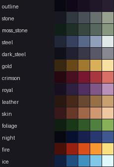

# Infinity Blade GBA: Art Style Guide

Oct 16, 2026 · milestone 5, task 5

## The look

The target is the GBA Castlevania games (Circle of the Moon, Harmony of Dissonance, Aria of Sorrow): gothic castle interiors, saturated characters with bold outlines, large detailed enemies, and an ornate gold-framed HUD. The references are for style only: no sprite, tile or palette is copied from them.

Measuring the reference screenshots at the GBA's native 240x160 gave five rules this guide is built on:

1. **Dark overall.** Most of the screen sits below about 45% brightness. Bright pixels are kept for focal points: blade edges, highlights, telegraphs and the HUD.
2. **Muted midtones, saturated accents.** Stone, armor and shadow are grey-greens and grey-purples with little saturation. Crimson, gold and royal blue are kept for cloth, trim and magic.
3. **Hue-shifted shading.** Shadows lean cool (blue or purple), highlights lean warm (cream or yellow), instead of a single color getting darker and lighter.
4. **Tinted near-blacks.** Outlines and the deepest shadows are never pure black; they carry a hint of blue, purple or the material's own hue.
5. **Backgrounds sit behind the fighters.** Backgrounds are darker and duller than the characters, so the hero and enemy always read first.

## Color ramps

Every material has a 5-step ramp, darkest to lightest. The ramps are original, tuned against the reference measurements, and live in `tools/art_style.py`, where every art generator reads them.

| Ramp | Used for |
| --- | --- |
| outline | Outlines and the deepest shadows |
| stone, moss_stone | Walls, floors, pillars; moss_stone for the garden and older stone |
| steel, dark_steel | Armor and blades; dark_steel for shadowed armor and the Brute |
| gold | Trim, crowns, hilts, the HUD frame |
| crimson | Cloth, banners, the hero's cape, blood |
| royal | The God King and the throne room |
| leather, skin | Grips, belts, boots; faces and hands |
| foliage, night | The garden; skies and the gate at night |
| fire, ice | Spell and element effects |

## Lighting and shading

- **Key light from the top left**, shared by the hero, the enemy and the backgrounds.
- **A thin cool rim on the enemy's back-right edge** separates him from the background.
- **Three to four ramp steps per surface**: a highlight, a base and one or two shadows. Five steps only on large, important shapes (the enemy's armor plates).
- **Dithering sparingly**, as a checker between two neighboring ramp steps on large background gradients (skies, distant walls). Never on characters.

## Outlines

- **1 px outlines on characters and markers**, using the darkest step of the material's own ramp or the outline ramp, never pure black.
- **Selective outlining on large sprites**: on the lit (top-left) edges the outline can step up to a dark shade of the fill, so big shapes don't look cut out.
- **No outlines on background tiles**, except where an object (a pillar, a door, the throne) needs to separate from the wall behind it.

## Combat readability rules

Art never trumps reading the fight:

- **Every wind-up pose must read from its silhouette alone.** The weapon's position (high left, high right, pulled back, raised, dropped low, at the waist, pointing down) is the telegraph.
- **The blade is always the highest-contrast thing on the enemy**: steel ramp highlights against his darker armor.
- **The telegraph trail and red unblockable glow stay pure effect colors** (gold and red) that nothing in a background or enemy palette reuses.
- **The enemy's upper body and weapon are never covered** by the hero, the HUD or background detail.

## Technical limits

- **16 colors per image**, with index 0 transparent (magenta in the files). The GBA's colors are 15-bit, so every value is a multiple of 8 per channel.
- **Enemy pose art shares one palette layout**, so the Brute, Duelist and God King can be palette swaps of the same pixels. Index meanings: 1 outline, 2 armor dark, 3 armor mid, 4 armor light, 5 visor glow, 6 blade, 7 blade edge, 8 leather, 9 trim.
- **Sprite sheets stack frames vertically.** Widths and frame heights are 8, 16, 32 or 64.
- **Backgrounds are 256x256.** With the background at (0, 0), the screen shows columns 8 to 247 and rows 48 to 207.

## Asset list

Every image the game uses, its size and frame layout. Final art must keep these sizes (and, for enemy poses, the palette layout) so the code doesn't change.

| Image | Size | Frames / notes |
| --- | --- | --- |
| hero | 64x64 sprite | 5 frames: idle, dodge (leans right, flipped for left), duck, block (shield raised), parry/slash (sword to the upper left, flipped for right) |
| enemy_<kit>_idle, \_wu\_\*, \_st\_\*, \_fall\_stagger, \_fall\_kneel | 256x256 backgrounds | Per kit (knight, brute, duelist, god_king): idle, a wind-up (wu) and strike (st) for each of 9 attacks, and two defeat poses. The figure stands centered on column 128, feet on rows 186-193. Every kit shares one palette layout (1 outline, 2-6 armor, 7 visor, 8-10 blade, 11-13 cloth, 14 leather, 15 trim) |
| enemy_look_<id> | 8x8 palette-only images | One per named enemy (14), applied over its kit's poses |
| area_gate, area_garden, area_barracks, area_great_hall, area_throne_approach, area_throne_room | 256x256 backgrounds | Each area's duel arena and area screen; the wall meets the floor at row 144 |
| title | 256x256 background | The castle at night behind the title screen |
| menu_frame | 256x256 background | Gold-trimmed border around the gate, character and equipment screens; transparent inside |
| area_band | 256x256 background | Dark title band across the top 26 rows of the area and story screens |
| title_logo | 256x256 background | "INFINITY GBLADE" in beveled gold, on its own layer so the castle behind it can be dimmed |
| markers | 16x16 sprite | 11 frames: duel, duel won, gold, gold taken, chest, chest open, locked chest, exit, exit blocked, God King, elite |
| telegraph | 8x8 sprite | 2 frames: normal (gold), unblockable (red) |
| sparks | 16x16 sprite | 8 frames: gold burst (4), blue burst (4) |
| digits | 8x8 sprite | 44 frames: 0-9 and + in white, gold, red and green |
| arrows | 16x16 sprite | 12 frames: up, down, left, right in dim, lit and mistake red |
| hp_bar | 8x8 sprite | 27 frames: 0-8 px of fill for the hero (green), enemy (red) and super (gold) bars |
| bar_caps | 8x8 sprite | 2 frames: left and right gold end caps for the bars |
| shield_pip, charge_orb | 8x8 sprites | 2 frames each: full, empty |
| common_variable_8x8_font | 8x8 sprite font | From Butano; may be replaced by a custom font with the HUD |

## The pipeline

1. **Generate**: art is made in code, using the ramps in `tools/art_style.py`: `make_hero_art.py` (hero), `make_enemy_art.py` (enemy kits, poses and named looks), `make_background_art.py` (areas and title), `make_ui_art.py` (bars, caps, pips, orbs, markers, menu frame, area band, title logo) and `make_placeholder_art.py` (the rest: telegraphs, sparks, digits, arrows).
2. **Preview**: `python3 tools/preview_art.py <images> -o sheet.png` renders frames; `--duel <background>` mocks the duel screen. To see the real thing, `tools/headless/run.sh <script>` plays the built ROM headlessly and saves screenshots (scripts in `tools/headless/scripts/`).
3. **Review**: preview sheets go to the user before anything changes in the game.
4. **Build**: `make`, then check in mGBA and on hardware.

**Bringing in outside art:** `python3 tools/png_to_gba.py <image.png> <name> --type sprite|bg` converts any image (a sketch, or a licensed asset pack) to a game-ready 16-color BMP with its Butano settings, enforcing the sizes above. `--palette-from graphics/enemy_knight_idle.bmp` maps an enemy pose onto the shared enemy palette, so palette swaps keep working.

**References** go in `references/` in the project folder. That folder is kept out of git, since screenshots of other games shouldn't be published with the project.
